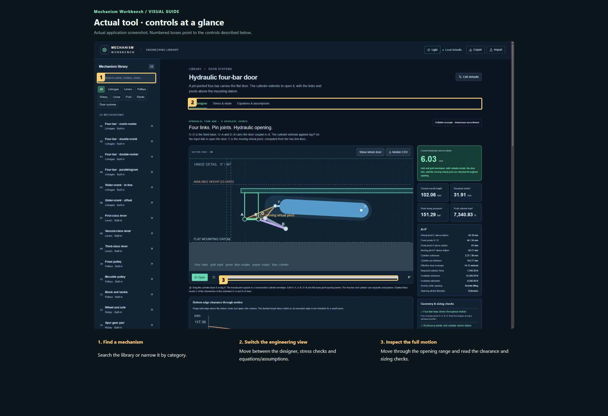
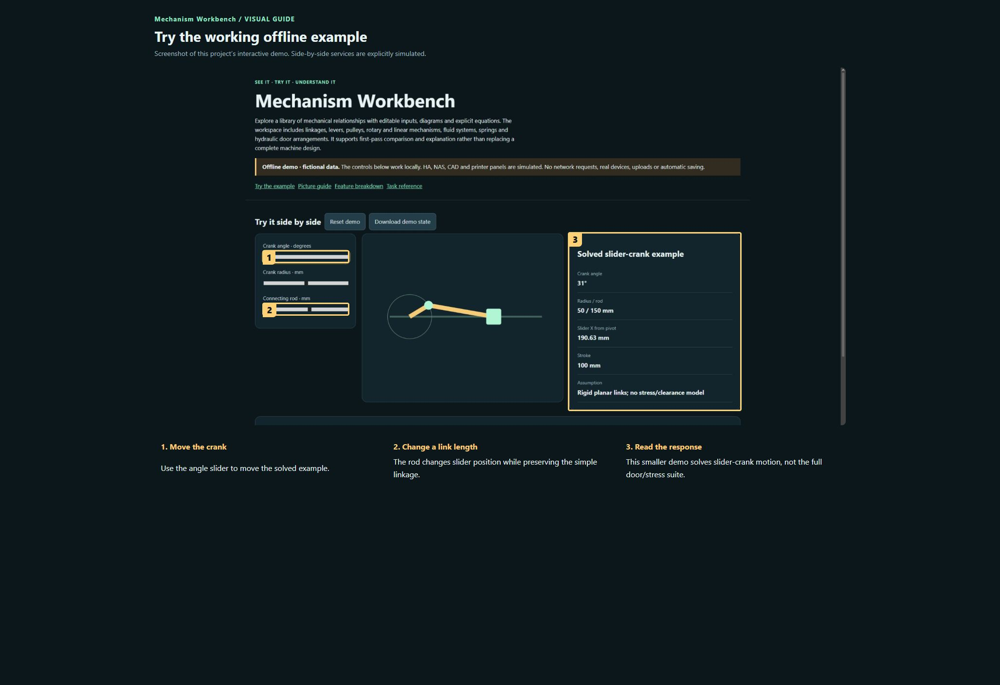

# Mechanism Workbench

Explore a library of mechanical relationships with editable inputs, diagrams and explicit equations. The workspace includes linkages, levers, pulleys, rotary and linear mechanisms, fluid systems, springs and hydraulic door arrangements. It supports first-pass comparison and explanation rather than replacing a complete machine design.

**Private preview · not published.**

[Open the visual manual](docs/USER-MANUAL.md) · [Download the self-contained demo](demo.html) · [Release notes](CHANGELOG.md)

Download `demo.html` using GitHub’s Download raw file control, then open it in your browser. GitHub displays HTML source; it does not run the demo on this page. The demo is an offline simulation with fictional data and makes no network requests.

## See it

### Actual tool · controls at a glance

Actual application screenshot. Numbered boxes point to the controls described below. 

1. **Find a mechanism.** Search the library or narrow it by category.
2. **Switch the engineering view.** Move between the designer, stress checks and equations/assumptions.
3. **Inspect the full motion.** Move through the opening range and read the clearance and sizing checks.

### Try the working offline example

Screenshot of this project’s interactive demo. Side-by-side services are explicitly simulated.

1. **Move the crank.** Use the angle slider to move the solved example.
2. **Change a link length.** The rod changes slider position while preserving the simple linkage.
3. **Read the response.** This smaller demo solves slider-crank motion, not the full door/stress suite.

## What this tool does

| Feature | What it lets you do | Where |
| --- | --- | --- |
| Library and search | Twenty-four built-in mechanisms grouped by category. | Interactive workspace |
| Equations and assumptions | Inspect the model behind a result instead of relying on an unexplained output. | Interactive workspace |
| Linkage Studio | Enter the dedicated linkage-design workspace from the library. | Interactive workspace |
| Door designer | Adjust four-bar geometry, cylinder mounting and door clearance through motion. | Interactive workspace |
| Stress & strain | Use sizing loads in the related stress checks. | Interactive workspace |
| Local defaults and exports | Edit/save defaults, export/import a workspace and export door motion CSV. | Interactive workspace |

## A first useful workflow

### Compare a mechanism

1. Search by name or choose a category, then select a built-in mechanism.
2. Read the description and open Equations & assumptions before changing inputs. Note units and whether the model is quasi-static.
3. Change one dimension or load and compare the diagram and result. Save as defaults only when you want the new baseline on this device.

## Saving and outputs

Defaults are browser-local. Export/import carries the workspace between devices. A CSV records motion results but does not necessarily preserve every editable setting.

## Running the actual tool

Open external-sources/StandaloneTools/mechanism-workbench.html in a browser.

The demo has no prerequisites; the real tool may need the services described in the manual and retained source notes.

## Current boundaries

The door preview uses sampled motion and conservative envelopes. It does not certify collisions or strength of a finished 3D assembly. The screenshot uses the included editable example, whose dimensions are explicitly unconfirmed.

## Licence and sharing

MIT applies to original project contributions. Bundled/upstream software and assets retain their own terms; see [third-party notes](THIRD-PARTY.md). Keep this repository private until its own [release checklist](RELEASE-CHECKLIST.md) is complete and the owner authorises publication.
